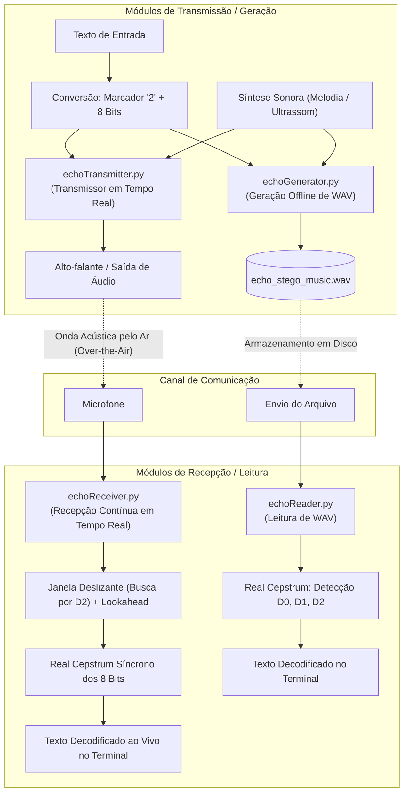
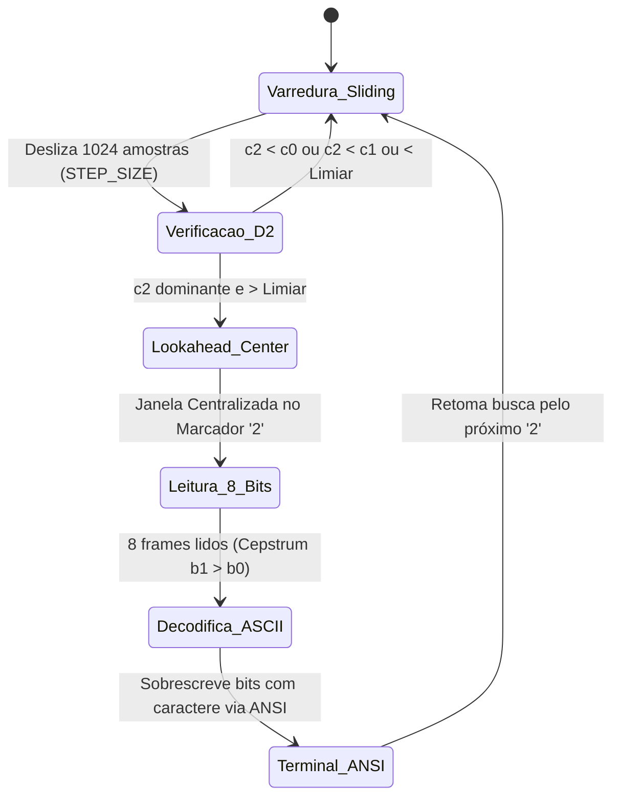

# USP-Sensores-Project: Esteganografia em Áudio por Ocultação de Eco (*Echo Hiding*)

[](https://www.python.org/downloads/)
[](LICENSE)
[]()
[]()

> Sistema de **Esteganografia em Áudio** e **Comunicação Acústica Sem Fio (*Over-the-Air*)** via modulação por **Ocultação de Eco (*Echo Hiding*)** e decodificação no domínio da **Quefrência (*Real Cepstrum*)**, desenvolvido para a disciplina de Sensores da Universidade de São Paulo (USP).

---

## Tabela de Conteúdos

- [O que é Esteganografia em Áudio?](#o-que-é-esteganografia-em-áudio)
  - [Esteganografia vs. Criptografia](#esteganografia-vs-criptografia)
  - [Psicoacústica e Mascaramento Temporal](#psicoacústica-e-mascaramento-temporal)
  - [Por que Ocultação de Eco (Echo Hiding)?](#por-que-ocultação-de-eco-echo-hiding)
- [Fundamentação Matemática do Echo Hiding](#fundamentação-matemática-do-echo-hiding)
  - [1. Equação no Domínio do Tempo](#1-equação-no-domínio-do-tempo)
  - [2. Efeito no Domínio da Frequência (Modulação Periódica)](#2-efeito-no-domínio-da-frequência-modulação-periódica)
  - [3. O Domínio da Quefrência e a Dedução do Real Cepstrum](#3-o-domínio-da-quefrência-e-a-dedução-do-real-cepstrum)
  - [4. Tabela de Símbolos e Delays ($D_0, D_1, D_2$)](#4-tabela-de-símbolos-e-delays-d_0-d_1-d_2)
  - [5. Suavização de Transição Cossenoidal](#5-suavização-de-transição-cossenoidal)
- [Arquitetura Geral dos 4 Módulos](#arquitetura-geral-dos-4-módulos)
- [Demonstrações em Vídeo (Espaços Reservados)](#demonstrações-em-vídeo-espaços-reservados)
- [Estrutura do Repositório](#estrutura-do-repositório)
- [Módulos Base (`constants.py` e `functions.py`)](#módulos-base-constantspy-e-functionspy)
- [Detalhamento, Funcionamento e Uso dos 4 Programas](#detalhamento-funcionamento-e-uso-dos-4-programas)
  - [1. `echoGenerator.py` (Codificador Offline para Arquivo WAV)](#1-echogeneratorpy-codificador-offline-para-arquivo-wav)
  - [2. `echoReader.py` (Decodificador Offline de Arquivo WAV)](#2-echoreaderpy-decodificador-offline-de-arquivo-wav)
  - [3. `echoTransmitter.py` (Transmissor Acústico Contínuo em Tempo Real)](#3-echotransmitterpy-transmissor-acústico-contínuo-em-tempo-real)
  - [4. `echoReceiver.py` (Receptor Acústico Contínuo via Microfone)](#4-echoreceiverpy-receptor-acústico-contínuo-via-microfone)
- [Instalação e Pré-requisitos](#instalação-e-pré-requisitos)
- [Guia Rápido de Testes](#guia-rápido-de-testes)
- [Dicas de Calibração e Solução de Problemas](#dicas-de-calibração-e-solução-de-problemas)

---

## O que é Esteganografia em Áudio?

### Esteganografia vs. Criptografia
A palavra **Esteganografia** tem origem grega (*steganos* = oculto, *graphie* = escrita) e designa a arte e ciência de esconder a própria existência de uma mensagem secreta dentro de um canal ou mídia hospedeira aparentemente inocente (áudio, imagem ou vídeo).

| Característica | Criptografia | Esteganografia em Áudio |
| :--- | :--- | :--- |
| **Objetivo Principal** | Proteger o sigilo do conteúdo | Ocultar a própria existência da transmissão |
| **Aparência dos Dados** | Texto truncado/aleatório incompreensível | Áudio comum (música, fala ou tom ambiente) |
| **Detecção por Terceiros** | O adversário sabe que há uma mensagem confidencial cifrada | O ouvinte sequer desconfia que dados estão sendo trafegados |

### Psicoacústica e Mascaramento Temporal
Para esconder dados em sinais sonoros sem degradar a qualidade percebida pelo ser humano, a esteganografia apoia-se nas limitações do **Sistema Auditivo Humano** (*Human Auditory System* - HAS):

1. **Limiar de Percepção de Eco**: Se uma cópia atenuada de um som chega aos ouvidos com um atraso inferior a aproximadamente $5\text{ a }10\text{ ms}$, o cérebro humano é incapaz de resolver os dois sons separadamente (fenômeno relacionado ao Efeito Haas). Em vez de ouvir um eco distinto, o ouvinte percebe apenas uma levíssima coloração de timbre ou reverberação de sala natural.
2. **Mascaramento Temporal (*Forward e Backward Masking*)**: Sons de maior intensidade tornam inaudíveis sons de menor intensidade que ocorram imediatamente antes (pré-mascaramento, $\sim 2\text{ ms}$) ou logo após (pós-mascaramento, até $\sim 50\text{ ms}$).

### Por que Ocultação de Eco (*Echo Hiding*)?
Ao contrário de técnicas ingênuas como a substituição de bits menos significativos (**LSB** - *Least Significant Bit*), que são extremamente frágeis e se perdem completamente em transmissões físicas, conversão digital-analógica (DAC/ADC) ou ruído ambiente, o **Echo Hiding** apresenta vantagens decisivas:
- **Resiliência Acústica (*Over-the-Air*)**: Os ecos propagam-se através do ar pelo alto-falante e resistem à atenuação, reflexões e ruídos moderados de ambiente.
- **Inaudibilidade**: Utilizando fatores de atenuação controlados ($\alpha = 0.5$) e atrasos na faixa de $3$ a $6.5\text{ ms}$, a alteração é imperceptível para a audição humana cotidiana, especialmente quando a portadora é uma melodia musical ou onda ultrassônica.
- **Detecção Cega (*Blind Decoding*)**: O receptor não precisa ter uma cópia do áudio limpo original para extrair a informação transmitida.

---

## Fundamentação Matemática do Echo Hiding

### 1. Equação no Domínio do Tempo
A inclusão de uma réplica atrasada de um sinal discreto $x[n]$ com atraso de $d$ amostras e atenuação $\alpha$ é descrita por:

$$y[n] = x[n] + \alpha \cdot x[n - d]$$

Em termos de convolução linear discreta:

$$y[n] = x[n] * h[n], \quad \text{onde } h[n] = \delta[n] + \alpha \cdot \delta[n - d]$$

Sendo $\delta[n]$ o impulso unitário discreto de Dirac/Kronecker.

---

### 2. Efeito no Domínio da Frequência (Modulação Periódica)
Aplicando a Transformada Discreta de Fourier (DTFT) à resposta ao impulso $h[n]$:

$$H(\omega) = 1 + \alpha e^{-j\omega d}$$

A transformada do sinal esteganografado $Y(\omega)$ resulta em:

$$Y(\omega) = X(\omega) \cdot (1 + \alpha e^{-j\omega d})$$

Calculando o espectro de potência / magnitude:

$$|Y(\omega)|^2 = |X(\omega)|^2 \cdot |1 + \alpha e^{-j\omega d}|^2$$

$$|1 + \alpha e^{-j\omega d}|^2 = (1 + \alpha \cos(\omega d))^2 + (\alpha \sin(\omega d))^2 = 1 + 2\alpha \cos(\omega d) + \alpha^2$$

Tomando o logaritmo natural da magnitude e utilizando a aproximação de Taylor $\ln(1 + u) \approx u$ para $\alpha \ll 1$:

$$\ln |Y(\omega)| = \ln |X(\omega)| + \frac{1}{2}\ln\left(1 + 2\alpha \cos(\omega d) + \alpha^2\right) \approx \ln |X(\omega)| + \alpha \cos(\omega d)$$

> [!NOTE]
> Observe o termo $\alpha \cos(\omega d)$: a presença do eco introduz uma **ondulação periódica (*ripple*)** no espectro logarítmico, cuja frequência em relação à escala angular é exatamente igual ao atraso temporal $d$.

---

### 3. O Domínio da Quefrência e a Dedução do Real Cepstrum
Como o espectro do áudio original $\ln |X(\omega)|$ é tipicamente suave e varia lentamente em frequência, a ondulação $\alpha \cos(\omega d)$ se destaca como um componente quase senoidal puro.

Para mensurar a frequência dessa ondulação, aplica-se a **Transformada Inversa de Fourier (IFFT)** sobre o log-espectro, transpondo o sinal para o domínio da **Quefrência** (*Quefrency*, jogo de palavras com *frequency*). Essa operação define o **Real Cepstrum** $c[q]$:

$$c[q] = \text{Re}\Big( \text{IFFT}\big( \ln|\text{FFT}(y[n] \cdot w[n])| + \varepsilon \big) \Big)$$

Onde:
- $w[n]$ é uma janela de ponderação de Hann de tamanho $L$ (`FRAME_LEN = 4096`), que anula as bordas para mitigar o vazamento espectral (*spectral leakage*).
- $\varepsilon = 10^{-12}$ é um fator de estabilização numérica contra $\ln(0)$.
- $q$ é a variável de quefrência, dada na **mesma unidade do tempo discreto (amostras)**.

Ao aplicar a linearidade da IFFT:

$$c[q] = \text{Cepstrum}\{x[n]\} + \text{Cepstrum}\{h[n]\}$$

Expandindo o termo do eco $\ln(1 + \alpha e^{-j\omega d})$ via série de potências $\sum_{k=1}^{\infty} \frac{(-1)^{k+1}}{k} \alpha^k e^{-jk\omega d}$:

$$\text{Cepstrum}\{h[n]\} = \alpha \cdot \delta[q - d] - \frac{\alpha^2}{2} \cdot \delta[q - 2d] + \frac{\alpha^3}{3} \cdot \delta[q - 3d] - \dots$$

**Conclusão Matemática Central:**
- A componente natural da música/voz $\text{Cepstrum}\{x[n]\}$ decai muito rapidamente e fica confinada em quefrências extremamente baixas ($q \approx 0$).
- O primeiro termo do eco gera um **pico proeminente e agudo exatamente em $q = d$**, com amplitude proporcional a $\alpha$.
- Assim, basta verificar em qual índice de atraso acordado ($D_0, D_1$ ou $D_2$) o Cepstrum atinge seu valor máximo para inferir com exatidão o símbolo embutido naquele quadro!

---

### 4. Tabela de Símbolos e Delays ($D_0, D_1, D_2$)

A taxa de amostragem padrão é $F_s = 44100\text{ Hz}$. Os valores de delay foram escolhidos para serem **não-harmônicos** entre si, minimizando interferência cruzada no Cepstrum. O sistema codifica 3 símbolos discretos:

| Símbolo | Atraso ($d$) | Atraso em Milissegundos | Função no Protocolo |
| :---: | :---: | :---: | :--- |
| **`0`** | $D_0 = 158\text{ amostras}$ | $\tau_0 = \frac{158}{44100} \approx 3.582\text{ ms}$ | Bit de dado binário **`0`** |
| **`1`** | $D_1 = 215\text{ amostras}$ | $\tau_1 = \frac{215}{44100} \approx 4.876\text{ ms}$ | Bit de dado binário **`1`** |
| **`2`** | $D_2 = 285\text{ amostras}$ | $\tau_2 = \frac{285}{44100} \approx 6.463\text{ ms}$ | **Marcador de Sincronismo** (Início de caractere ASCII) |

#### Protocolo de Enquadramento de Caracteres:
Cada caractere alfanumérico ASCII (1 byte) é convertido em 8 bits e precedido pelo marcador `'2'`. Logo, cada caractere ocupa $9$ quadros de áudio:
$$\text{Caractere 'B'} \xrightarrow{\text{ASCII 66}} \underbrace{\text{'2'}}_{\text{Frame de Sincronismo}} + \underbrace{\text{'01000010'}}_{\text{8 Frames de Bits de Dados}} \quad (9 \times \text{FRAME\_LEN amostras})$$

---

### 5. Suavização de Transição Cossenoidal
Quando o símbolo se altera de um quadro para o seguinte (por exemplo, de `'0'` para `'1'`), somar os ecos bruscamente geraria descontinuidade de primeira derivada, traduzindo-se em cliques audíveis de alta frequência.

Para solucionar isso, o sistema implementa uma transição suave cossenoidal (*Hann half-ramp*) sobre as primeiras $K$ amostras do bloco ($K = \frac{\text{FRAME\_LEN}}{30} \approx 136\text{ amostras}$):

$$m[n] = \begin{cases} 
v_{\text{prev}} + (v_{\text{curr}} - v_{\text{prev}}) \cdot \frac{1}{2}\left(1 - \cos\left(\frac{\pi n}{K}\right)\right), & 0 \le n < K \\
v_{\text{curr}}, & K \le n < \text{FRAME\_LEN}
\end{cases}$$

Onde $v \in \{0.0, 1.0\}$ indica a ativação do respectivo eco no quadro.

---

## Arquitetura Geral dos 4 Módulos



---

## Demonstrações em Vídeo (Espaços Reservados)


### Demonstração 1: Geração e Leitura Offline (`echoGenerator.py` & `echoReader.py`)
*Demonstração do pipeline completo em arquivo: inserção do texto secreto na melodia, geração do arquivo `.wav` e extração automática pelo leitor cepstral.*

<video width="90%" controls><source src="echoGenerator.mp4" type="video/mp4"></video>


---

### Demonstração 2: Transmissão e Recepção Acústica em Tempo Real (`echoTransmitter.py` & `echoReceiver.py`)
*Demonstração da transmissão acústica sem fio pelo ar: texto digitado no transmissor sendo emitido pelo alto-falante, capturado pelo microfone e decodificado ao vivo no terminal do receptor.*

<video width="90%" controls><source src="echoTransmitter.mp4" type="video/mp4"></video>

---

## Estrutura do Repositório

```plaintext
USP-Sensores-Project/
├── constants.py         # Constantes de DSP: taxas, delays D0/D1/D2, notas e melodias
├── functions.py         # Biblioteca matemática: Real Cepstrum, síntese e janelamento
├── echoGenerator.py     # [1] Codificador e sintetizador de áudio WAV offline
├── echoReader.py        # [2] Decodificador e extrator de mensagem de WAV offline
├── echoTransmitter.py   # [3] Transmissor contínuo em tempo real via alto-falante
├── echoReceiver.py      # [4] Receptor contínuo em tempo real via microfone
└── requirements.txt     # Dependências (numpy, sounddevice, scipy, matplotlib)
```

---

## Módulos Base (`constants.py` e `functions.py`)

### `constants.py`
Contém todas as configurações padronizadas do sistema:
- `SAMPLE_RATE = 44100`: Frequência de amostragem padrão (44.1 kHz).
- `FRAME_LEN = 4096`: Amostras por símbolo/bit ($\approx 92.88\text{ ms}$). Quadros maiores aumentam a resolução do Cepstrum, melhorando a separação dos picos.
- `D0 = 158`, `D1 = 215`, `D2 = 285`: Atrasos nominais em amostras, escolhidos para serem não-harmônicos entre si.
- `ALPHA = 0.5`: Fator de amplitude dos ecos — aumentado para melhorar a detecção em transmissões pelo ar.
- `K = FRAME_LEN // 30`: Tamanho da janela de transição cossenoidal (~136 amostras).
- `NOISE_THRESHOLD = 0.03`: Limiar mínimo de separação entre $D_2$ e os demais para validar o marcador de sincronismo.
- `NOTES`: Frequências em Hz das notas musicais e da portadora ultrassônica (`"ULTRA": 22000`).
- `MARIO`, `LOOPING`, `UNIFORM`, `ULTRASOUND`: Partituras de suporte.

### `functions.py`
Fornece os blocos de processamento digital de sinais:
- `text_to_bits(text)`: Converte cada caractere em ASCII de 8 bits e prefixa com o marcador `'2'`.
- `generate_melody(notes)`: Sintetiza as notas com harmônicos (fundamental a 25%, 2º harmônico a 50%, 3º a 25%). Para frequências ultrassônicas, usa onda senoidal pura com 70% de amplitude para prevenir aliasing harmônico em frequências audíveis. Aplica rampas de fade-in/out de 5 ms e adiciona ruído gaussiano ($\sigma = 0.008$) para garantir a propagação do eco mesmo durante pausas musicais.
- `create_chunk_mixer(prev, curr, target, frame_len, k)`: Constrói a curva de ponderação cossenoidal para a transição suave de ecos.
- `analyze_frame(frame)`: Normaliza o quadro pelo pico de amplitude para preservar a dinâmica logarítmica independentemente do nível de volume. Em seguida, aplica a janela de Hann, calcula a FFT, extrai $\ln|\text{FFT}|$ e aplica a IFFT (Real Cepstrum). Para acomodar dispersão do ar, jitter de microfone e desvios de clock, extrai o valor máximo em uma vizinhança de $\pm 3$ amostras:
  ```python
  c0 = np.max(rceps[c.D0 - 3 : c.D0 + 4])
  c1 = np.max(rceps[c.D1 - 3 : c.D1 + 4])
  c2 = np.max(rceps[c.D2 - 3 : c.D2 + 4])
  ```
- `bits_to_char(bit_str)`: Converte 8 bits em caractere ASCII legível.

---

## Detalhamento, Funcionamento e Uso dos 4 Programas

---

### 1. `echoGenerator.py` (Codificador Offline para Arquivo WAV)

#### Objetivo
Recebe uma mensagem de texto do usuário, sintetiza um áudio base portador sob medida, embutindo a mensagem na forma de atrasos $D_0, D_1$ e $D_2$, e exporta o resultado em um arquivo WAV de 16 bits.

#### Funcionamento Passo a Passo
1. **Entrada da Mensagem**: O usuário digita o texto secreto (ou pressiona Enter para usar `"Echo test"`).
2. **Cálculo da Capacidade**: O texto é convertido em símbolos com `text_to_bits()`. O programa calcula quantos ciclos da melodia base (`BASE_MELODY`) são necessários para acomodar a quantidade total de quadros de áudio requeridos:
   $$\text{Loops} = \max\left(1, \left\lceil \frac{\text{bits requeridos}}{\text{quadros por ciclo}} \right\rceil\right)$$
3. **Síntese da Portadora**: Gera o sinal contínuo limpo $x[n]$ via `generate_melody()`.
4. **Criação dos 3 Canais de Eco**:
   - `echo_zero`: $x[n - D_0] \cdot \alpha$
   - `echo_one`: $x[n - D_1] \cdot \alpha$
   - `echo_two`: $x[n - D_2] \cdot \alpha$
5. **Modulação por Máscaras**: Multiplica cada canal de eco por seu respectivo sinal modulador suave (`mix_0`, `mix_1`, `mix_2`), obtido via `create_mixer_signal()`.
6. **Gravação do Arquivo**: Aplica saturação com `np.clip(..., -32768, 32767)` e grava em formato WAV PCM 16-bit mono.

#### Como Executar
```bash
python echoGenerator.py
```
**Exemplo no Terminal:**
```text
=== ECHO HIDING AUDIO GENERATOR ===
Enter the secret message to hide in the audio: USP Sensores

required bits 108 for 12 characters...
samples_per_cycle 17640 and frames_per_cycle 8

Generating music (14 loops to fit 12 characters)...
Embedding secret message into the audio...
Done! File 'echo_stego_music.wav' successfully generated.
```

---

### 2. `echoReader.py` (Decodificador Offline de Arquivo WAV)

#### Objetivo
Lê um arquivo WAV esteganografado, processa cada quadro de áudio no domínio da quefrência, localiza os marcadores de sincronismo e reconstrói o texto original sem necessitar de nenhum sinal de referência limpo.

#### Funcionamento Passo a Passo
1. **Carregamento e Normalização**: Lê os bytes brutos do WAV usando o módulo nativo `wave`, converte para ponto flutuante em $[-1.0, 1.0]$. Se o áudio possuir múltiplos canais, faz a média para obter um sinal mono.
2. **Varredura por Quadros**: Itera de $k=0$ até $\lfloor N / \text{FRAME\_LEN} \rfloor$, fatiando o áudio em blocos de 4096 amostras.
3. **Classificação Cepstral**:
   - Executa `f.analyze_frame(frame)`.
   - Avalia as amplitudes dos picos:
     - Se $c_2 \ge c_0$ e $c_2 \ge c_1 \rightarrow$ Símbolo `'2'`.
     - Senão, se $c_1 \ge c_0 \rightarrow$ Bit `'1'`.
     - Senão $\rightarrow$ Bit `'0'`.
4. **Extração de Caracteres**:
   - Percorre a cadeia de símbolos decodificados buscando o marcador `'2'`.
   - Ao encontrar `'2'`, lê os 8 bits seguintes:
     ```python
     byte_str = symbol_str[i + 1 : i + 9]
     ascii_code = int(byte_str, 2)
     chars.append(chr(ascii_code))
     i += 9  # Salta para o próximo caractere
     ```

#### Como Executar
```bash
python echoReader.py
```
**Exemplo no Terminal:**
```text
=== ECHO HIDING AUDIO DECODER ===
Enter WAV file to decode (press Enter for 'echo_stego_music.wav'): 

Loading 'echo_stego_music.wav'...
Analyzing echoes and extracting message...

Decoded Symbols:  201010101 201010011 201110000 200100000 201010011 201100101 201101110 201110011 201101111 201110010 201100101 201110011
Decoded Message: USP Sensores
```

---

### 3. `echoTransmitter.py` (Transmissor Acústico Contínuo em Tempo Real)

#### Objetivo
Opera como um modem acústico. Reproduz um fluxo de áudio contínuo e ininterrupto pela placa de som enquanto lê mensagens digitadas pelo usuário no terminal, transmitindo-as instantaneamente pelo alto-falante.

#### ⚙️ Funcionamento Passo a Passo
1. **Callback de Áudio Assíncrono (`audio_callback`)**: Utiliza `sounddevice.OutputStream` com `blocksize = FRAME_LEN`. A cada requisição de 4096 amostras da placa de som:
   - Fatia o próximo pedaço da melodia em loop (`indices = (np.arange(FRAME_LEN) + pos) % melody_len`).
   - Retira o próximo símbolo da fila `bit_queue`. Se a fila estiver vazia, `curr_symbol = None` — nenhum eco é adicionado e o áudio transmitido é limpo (sem dados embutidos).
2. **Buffer de Continuidade de Fase (`history`)**:
   - Como os ecos necessitam de até $D_2 = 285$ amostras anteriores para serem calculados, um corte seco entre blocos de callback causaria descontinuidade nos ecos.
   - O transmissor concatena um buffer de histórico contendo as últimas 285 amostras do bloco anterior com o bloco atual:
     ```python
     extended = np.concatenate([history, chunk])
     echo_zero = ALPHA * extended[D2 - D0 : D2 - D0 + FRAME_LEN]
     echo_one  = ALPHA * extended[D2 - D1 : D2 - D1 + FRAME_LEN]
     echo_two  = ALPHA * extended[0 : FRAME_LEN]
     ```
   - Atualiza `history = chunk[-D2:].copy()` para o próximo callback.
3. **Fila Thread-Safe de Mensagens**:
   - A thread principal aguarda entrada do usuário (`input("Message > ")`).
   - Ao digitar um texto e pressionar Enter, o texto é convertido em símbolos e enfileirado no `bit_queue` sem bloquear a reprodução sonora.
4. **Melodia Padrão e Dispositivo de Áudio**:
   - Por padrão usa `BASE_MELODY = c.MARIO`. A configuração do dispositivo para `"pulse"` é feita dentro de um `try/except` para ser compatível com sistemas sem PulseAudio.

#### Como Executar
```bash
python echoTransmitter.py
```
**Exemplo no Terminal:**
```text
=== CONTINUOUS ECHO HIDING TRANSMITTER ===
Active Audio Device: default (pulse)
Playing music... Type a message and press Enter!
Type 'exit' to stop.

Message > Teste de transmissao
  [Queued 20 chars -> 180 symbols remaining]
Message > exit
Transmitter stopped.
```

---

### 4. `echoReceiver.py` (Receptor Acústico Contínuo via Microfone)

#### Objetivo
Captura áudio continuamente do microfone, realiza varredura com janela deslizante para sincronizar no marcador $D_2$ mesmo sem clock compartilhado, extrai os 8 bits seguintes e renderiza o caractere ASCII ao vivo no terminal.

#### Funcionamento Passo a Passo



1. **Janela Deslizante de Busca (`STEP_SIZE = 1024` amostras)**:
   - Em uma transmissão acústica real, o receptor não sabe quando a mensagem iniciará.
   - O receptor avança em passos curtos de $\frac{1}{4}$ de quadro (`FRAME_LEN // 4 = 1024` amostras), mantendo um buffer circular de 4096 amostras e calculando o Cepstrum.
2. **Detecção do Marcador $D_2$ e Limiar de Ruído**:
   - Verifica se $c_2 > c_0$ e $c_2 > c_1$, e se a diferença $(c_2 - \max(c_0, c_1)) > \text{NOISE\_THRESHOLD}$ (evitando disparos acidentais por ruído de sala).
3. **Alinhamento Central por Lookahead (*Peek Step*)**:
   - Ao detectar $D_2$, o receptor lê mais 1024 amostras (`peek_data`) para checar a derivada do pico:
     - Se `next_c2 > c2`, o centro exato do pico está um passo à frente $\rightarrow$ avança a janela.
     - Se `next_c2 <= c2`, o pico já estava centrado $\rightarrow$ aproveita `peek_data` como o início do primeiro bit de dados.
4. **Leitura Síncrona dos 8 Bits**:
   - Uma vez alinhado, o receptor lê exatamente 8 blocos cheios de 4096 amostras.
   - Para cada bloco, avalia $b_1 > b_0$ e acumula o bit correspondente (`'1'` ou `'0'`).
5. **Atualização Dinâmica do Terminal via ANSI**:
   - Conforme os bits são recebidos, eles são impressos provisoriamente: `10110001`.
   - Ao completar o byte, envia a sequência de controle ANSI `\033[8D` (recua 8 posições no cursor) e imprime o caractere ASCII final + 7 espaços de limpeza, depois recua mais 7 (`\033[7D`) para posicionar o cursor logo após o caractere exibido.

#### Como Executar
```bash
python echoReceiver.py
```
**Exemplo no Terminal:**
```text
=== CONTINUOUS ECHO HIDING RECEIVER ===
Active Audio Device: default (pulse / sysdefault)
Press Ctrl+C to stop.

Decoded Text:
|  Teste de transmissao
```

---

## Instalação e Pré-requisitos

### 1. Requisitos do Sistema
- Python 3.10 ou superior.
- Sistema de áudio funcional (ALSA, PulseAudio ou PipeWire no Linux; CoreAudio no macOS; WASAPI no Windows).
- Microfone e alto-falantes conectados e configurados.

### 2. Clonar o Repositório e Configurar Ambiente
```bash
git clone https://github.com/SEU_USUARIO/USP-Sensores-Project.git
cd USP-Sensores-Project

# Criar ambiente virtual
python3 -m venv venv
source venv/bin/activate  # Linux/macOS
# ou venv\Scripts\activate no Windows
```

### 3. Instalar Dependências
```bash
pip install numpy sounddevice scipy matplotlib
```

---

## Guia Rápido de Testes

### Cenário A: Teste em Arquivo (Offline)
Ideal para verificar a integridade matemática da codificação e decodificação:
```bash
# Passo 1: Gerar áudio WAV com texto secreto
python echoGenerator.py

# Passo 2: Extrair a mensagem do arquivo
python echoReader.py
```

### Cenário B: Teste Acústico em Tempo Real (Over-the-Air)
Abra dois terminais independentes:

**Terminal 1 (Receptor):**
```bash
python echoReceiver.py
```

**Terminal 2 (Transmissor):**
```bash
python echoTransmitter.py
```
*Digite qualquer texto no Terminal 2 e pressione Enter. Observe as letras sendo decodificadas em tempo real no Terminal 1!*

---

## 💡 Dicas de Calibração e Solução de Problemas

1. **Volume de Reprodução**:
   - Mantenha o volume da caixa de som em nível moderado (50% a 70%). Volumes excessivos provocam saturação (*clipping*) e harmônicos espúrios que degradam a detecção dos ecos.
2. **Ajuste de Limiar de Ruído (`NOISE_THRESHOLD`)**:
   - Em ambientes muito barulhentos, aumente `NOISE_THRESHOLD` em `constants.py` para `0.06` ou `0.08` para evitar que ruídos externos simulem o marcador $D_2$.
   - Se o microfone estiver distante ou com ganho baixo, reduza para `0.01` ou `0.02`.
3. **Modo Ultrassônico ou Audível**:
   - Por padrão, `echoTransmitter.py` utiliza `BASE_MELODY = c.MARIO` (melodia audível do Super Mario) e `echoGenerator.py` utiliza `BASE_MELODY = c.UNIFORM` (tom constante audível).
   - Para tornar a portadora inaudível, mude para `c.ULTRASOUND` (senoidal a 19.5 kHz):
     ```python
     BASE_MELODY = c.ULTRASOUND  # Portadora senoidal inaudível (19.5 kHz)
     ```
   - Outras opções disponíveis:
     ```python
     BASE_MELODY = c.UNIFORM  # Tom constante audível (B4 = 493.88 Hz)
     BASE_MELODY = c.MARIO    # Melodia do Super Mario
     BASE_MELODY = c.LOOPING  # Melodia genérica loopável
     ```
4. **Problemas com Áudio no Linux (PipeWire / PulseAudio)**:
   - Caso o SoundDevice não capture áudio ou apresente erros de dispositivo ocupado, reinicie os serviços de áudio do usuário:
     ```bash
     systemctl --user restart pipewire pipewire-pulse wireplumber
     ```

---

## 👥 Autoria

Projeto desenvolvido no âmbito da disciplina de Sensores da Universidade de São Paulo (USP).